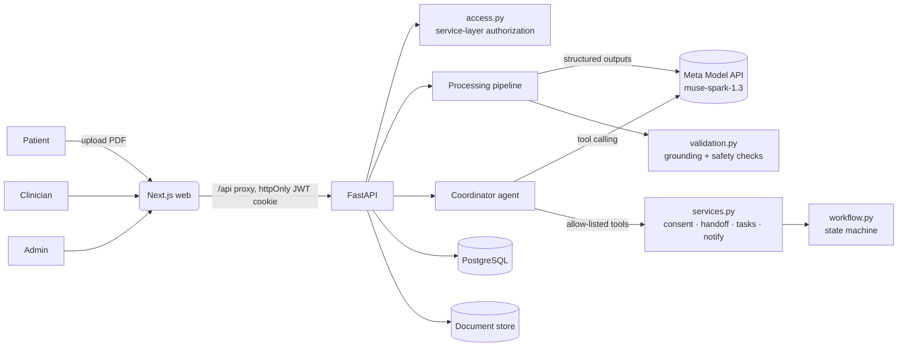

# CareBridge Architecture

CareBridge is a medical navigation and clinician handoff agent. A patient uploads a lab report; Meta models
extract and explain it; with explicit consent, an agent hands it to a clinician and tracks the case to closure.

## Components

| Component | Tech | Responsibility |
|---|---|---|
| Web app | Next.js 15, TypeScript, Tailwind, shadcn/ui, TanStack Query, React Hook Form + Zod | Patient, clinician and admin UIs. Proxies `/api/*` to the backend so the session cookie stays same-origin. |
| API + agents | Python 3.13, FastAPI, Pydantic v2, SQLAlchemy 2, Alembic | REST API, auth, authorization, workflow state machine, processing pipeline, coordinator agent. |
| Database | PostgreSQL 16 | All records, audit trail, agent executions, model-call telemetry. |
| Document store | Local volume (dev); key layout maps to a private S3 bucket | Original PDFs. |
| LLM | **Meta Model API**, `https://api.meta.ai/v1`, model `muse-spark-1.3` | Report understanding, explanations, clinician summaries, tool-calling coordination. |

> **Our call:** one Python service instead of NestJS + a separate Python agent. With one developer and a 2-day
> window, a single service removes a network hop, a second auth layer, and a duplicated data model. The
> service boundaries inside (`routers` → `services` → `workflow`, `agent/*`, `ai/*`) keep a later split cheap.

## Where Meta models are used

| # | Capability | Code | Meta call | Output schema |
|---|---|---|---|---|
| 1 | Medical report understanding | `agent/pipeline.py` step `meta_report_understanding` | Chat Completions + `response_format: json_schema` | `ExtractionResult` |
| 2 | Patient-friendly explanation | step `meta_patient_explanation` | structured output | `PatientExplanation` |
| 3 | Clinician handoff summary | step `meta_clinician_summary` | structured output | `ClinicianSummary` |
| 4 | Agent reasoning (which tools to run) | `agent/coordinator.py` | Chat Completions + `tools` (function calling) | tool calls, validated per tool |
| 5 | Follow-up coordination | `agent/coordinator.py` mode `FOLLOW_UP` | tool calling; the model writes the admin messages | `create_follow_up_task`, `notify_*` args |

The integration (`ai/provider.py`) uses the OpenAI-compatible Python SDK pointed at Meta's endpoint, as documented
at dev.meta.ai (quickstart, structured output, tool calling, models pages). The same Pydantic class generates the
JSON Schema sent to Meta and validates the reply. Every call writes a `model_calls` row: model id returned by the
API, status, latency, input/output/total tokens, and response id. It's visible under **Admin → Agent & Meta AI**.

## Deterministic vs. model responsibilities

| Deterministic backend (never the LLM) | Meta model |
|---|---|
| PDF text extraction, regex row parser | Reading the report into structured findings |
| Grounding: every value/unit/range/flag must appear verbatim on the cited page line | Plain-language explanation |
| Out-of-range computation from printed intervals | Clinician-facing summary draft |
| Safety lint (diagnosis, medication, reassurance, triage language), invented-number check, cross-output contradiction check | Choosing which workflow tool to call next |
| Consent enforcement, authorization, state transitions, idempotency, dedupe | Wording administrative follow-up messages |

## Processing pipeline (bounded workflow)

`document_processing → deterministic_parse → meta_report_understanding → finding_validation →
meta_patient_explanation → meta_clinician_summary → output_validation`

- Each step is persisted in `agent_executions.steps` (status, duration, counts) so the UI shows live progress.
- Invalid structured output is re-asked once with the validation error (max 2 attempts). API errors and timeouts
  use SDK retries (`AI_MAX_RETRIES`), then fail the case to `PROCESSING_FAILED`.
- If generated text fails validation, it's regenerated once with the issues listed. A second failure stores the summary as
  `FAILED_VALIDATION` and moves the case to `NEEDS_CORRECTION`. Failed summaries are never shown or shared.
- Findings the model misses but the parser found are kept (source line is the evidence). Model findings that can't be
  matched to source text are kept but marked `NEEDS_REVIEW`.

## Coordinator agent (tool calling)

The Meta model gets a goal plus an allow-listed toolset, and up to 6 reasoning turns:

| Tool | Modes | Backend guard |
|---|---|---|
| `get_case_snapshot` | all | read-only, contains no result values |
| `create_clinician_handoff` | HANDOFF | `services.create_handoff`: re-checks active consent, valid state, idempotent per consent |
| `create_follow_up_task` | all | kind must fit the current state; description must contain no medical detail; dedup per case+kind |
| `notify_patient` / `notify_clinician` | all | administrative-only text filter; clinician must hold an active consented handoff; one per run |

The model can't change case status. Status changes happen only in `workflow.transition`, called by services
after their own checks. Tool errors are returned to the model as data; the prompt forbids working around them. If a
HANDOFF run ends without a handoff, the run is marked failed and can be retried. It doesn't quietly succeed.

## Case state machine

`UPLOADED → PROCESSING → SUMMARY_READY → AWAITING_CONSENT → CONSENT_GRANTED → HANDOFF_SENT → ACKNOWLEDGED →
UNDER_REVIEW → REVIEW_COMPLETED → CLOSED`, plus `PROCESSING_FAILED`, `NEEDS_CORRECTION`, `CONSENT_WITHDRAWN`,
`HANDOFF_CANCELLED`. The full table is `TRANSITIONS` in `backend/app/workflow.py`. Every transition is audited.

## Data model

Organization, User, PatientProfile, ClinicianProfile, MedicalCase, MedicalDocument, ExtractedFinding, AISummary,
PatientConsent, ClinicalHandoff, ClinicalReview, FollowUpTask, Notification, AuditEvent, AgentExecution, ModelCall.
UUID keys, FKs, indexes, `uq_handoff_consent` (one handoff per consent), unique `follow_up_tasks.dedupe_key`.
Migration: `backend/migrations/versions/*_initial_schema.py`.

## API

OpenAPI at `http://localhost:8000/docs`. Route groups: `/api/auth`, `/api/patient`, `/api/clinician`,
`/api/admin`, `/api/agent`, `/api/notifications`. Errors use `{"error": {"code", "message"}}`.

## Deployment

See `docs/DEPLOYMENT_AWS.md`.
